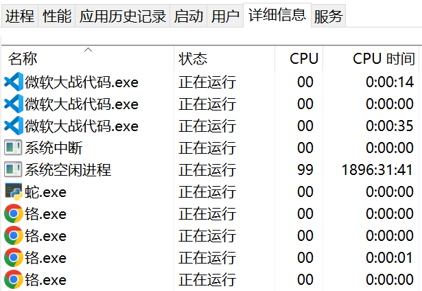

# 偷啃！

大家平时有用任务管理器吗？

任务管理器里的进程都是英文的，满屏幕英文谁看得懂啊！

还好聪明的莉沫酱发现了，只要把进程的名字改成中文，任务管理器显示的进程也就是中文了！

好，我们来把所有的进程都变成中文吧！


## 原理

是这样，进程的名字其实就是可执行程序的名字，所以很简单，只要把exe的名字改了就好了！

但这样就引入了1个新的问题，程序升级怎么办？

如果改成符号链接的话是没有用的，进程的名字不会变。如果改成硬链接，因为升级的时候通常是替换文件的，所以链接也会断开。

所以做法是这样，还是用硬链接，但是搞1个假的入口，让它去检查链接是不是指向同1个文件，如果不是就重建，然后再去启动那个链接的程序，这样1来就没有问题了！

顺带1提，然后以后黑客进入到你的电脑里，看到进程列表就会很害怕！


## 使用方法

打开 `偷啃.py`，在`偷`里面添加你要汉化<sub>(笑)</sub>的程序路径和名字，然后——

```cmd
python 偷啃.py
```

就可以了！

效果是这样:



大家都变成中文了呢！

不过桌面上的快捷方式之类的不会修改，你要去手动把他们改成刚才建出来的那个启动器！

此外，汉化chrome的时候发现，chrome的安装文件夹是没有写权限的，这种只能手动加1下权限了！


## 编译

不过这个仓库里有1个exe。

如果你担心我在里面放入坏的代码偷取你的秘密照片，也可以自己编译！

因为C++里也写了中文，所以如果用古代的编译器的话会挂掉。如果用Visual Studio送的MSVC编译的话，可以参考旁边的`编译.bat`！


## 结束

就这样，大家88，我要去蛇了！
